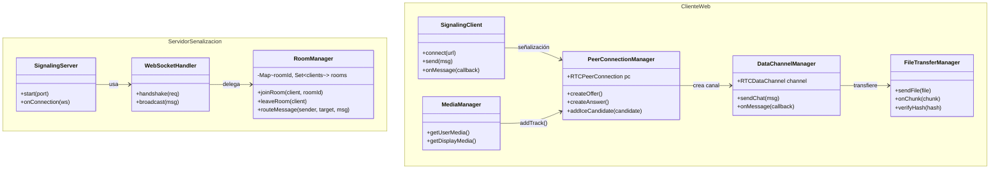
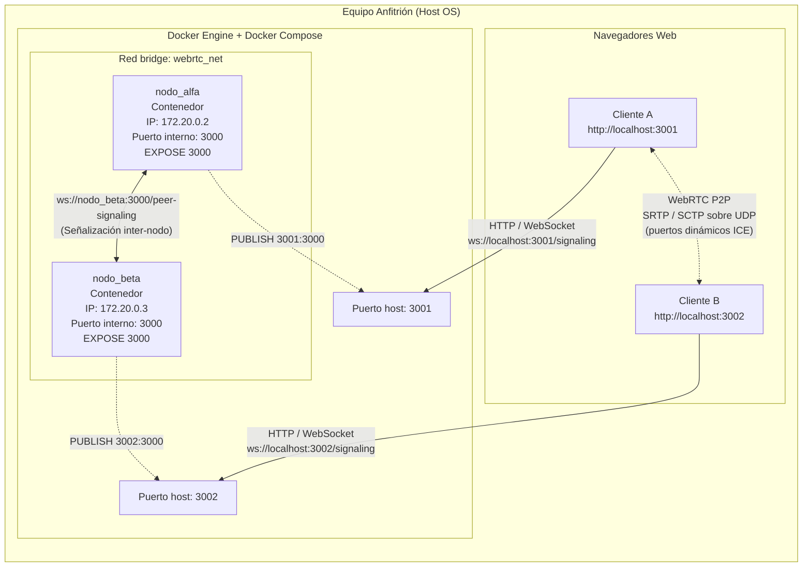
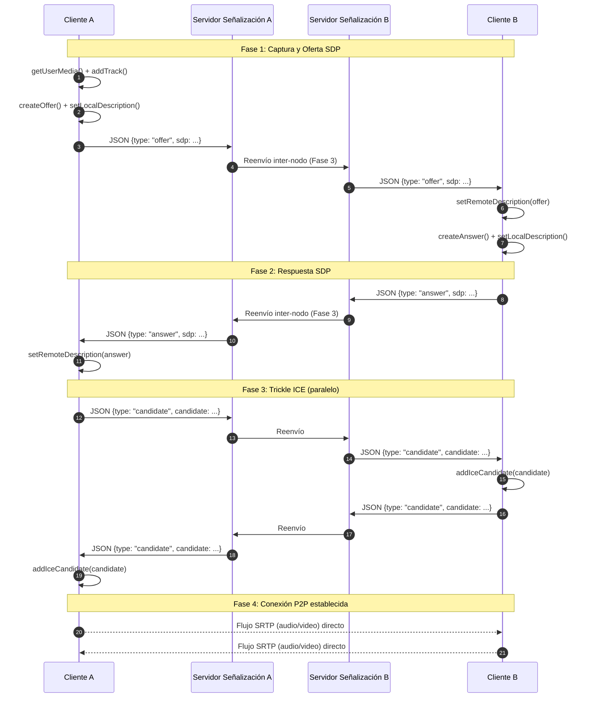
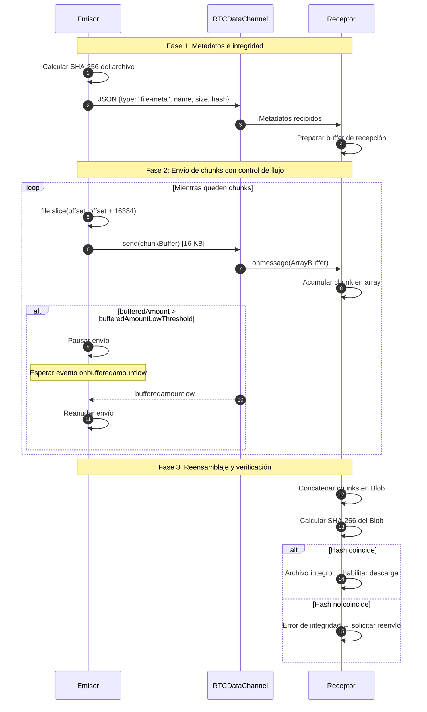
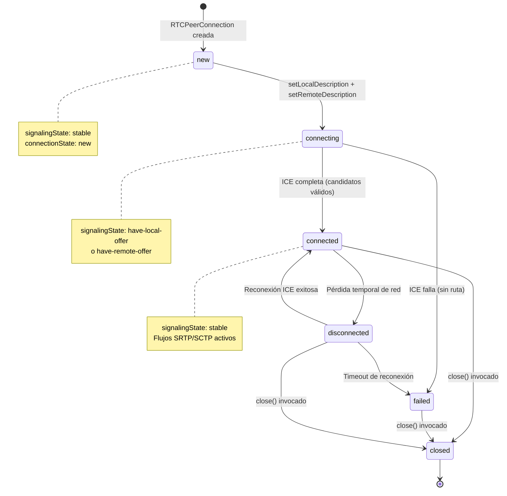

# INFORME DE INVESTIGACIÓN: FUNDAMENTOS TEÓRICOS PARA EL DESARROLLO DE UN MENSAJERO WEBRTC EN UNA ARQUITECTURA DISTRIBUIDA

## PARTE I. MARCO TEÓRICO Y FUNDAMENTACIÓN TÉCNICA

### CAPÍTULO 1. Virtualización y arquitectura de contenedores (BLOQUE A)

#### 1.1. Concepto y evolución de la virtualización

La virtualización abstrae y desacopla los recursos físicos (CPU, memoria, almacenamiento y red) de los entornos de ejecución de software. Históricamente, la computación sobre hardware "bare-metal" generaba subutilización de recursos, rigidez operativa y dificultades de aislamiento entre procesos [1]. Las capas de abstracción permitieron subdividir un servidor físico en entornos independientes, transformando la administración de infraestructura en una gestión declarativa definida por software [2]. En sistemas distribuidos, la virtualización es la base para la replicación de nodos, el despliegue reproducible y el aislamiento de fallos. Existen dos paradigmas dominantes: virtualización completa basada en hipervisores (Máquinas Virtuales) y virtualización a nivel de sistema operativo (Contenedores) [3].

#### 1.2. Virtualización completa e Hipervisores (Tipo 1 y Tipo 2)

La virtualización completa se fundamenta en un hipervisor o Monitor de Máquinas Virtuales (VMM), que emula hardware completo para que cada MV ejecute su propio sistema operativo huésped (Guest OS) independiente del anfitrión (Host OS) [2]. Los hipervisores se clasifican en dos categorías:

- **Tipo 1 (Bare-Metal o Nativos):** se ejecutan directamente sobre el hardware sin SO anfitrión intermedio. Ejemplos: VMware ESXi, KVM, Microsoft Hyper-V [2]. Ofrecen máximo rendimiento y menor latencia de emulación, siendo el estándar en centros de datos.
- **Tipo 2 (Hosted o Alojados):** se ejecutan como aplicación sobre un SO anfitrión (Windows, Linux, macOS). Ejemplos: Oracle VirtualBox, VMware Workstation [4]. Las peticiones del Guest OS pasan por el hipervisor, el Host OS y el hardware, lo que introduce un mayor overhead computacional.

Cada MV encapsula la aplicación, sus dependencias y la imagen completa del SO huésped (kernel, controladores, servicios) [5]. El aislamiento a nivel de hardware es muy fuerte: un kernel panic en una MV no afecta a las demás. A cambio, implica imágenes de varios gigabytes, alta RAM reservada y arranques de decenas de segundos a minutos [1].

#### 1.3. Virtualización a nivel de Sistema Operativo: Contenedores Docker

La contenerización no emula hardware ni ejecuta múltiples kernels: comparte el kernel del anfitrión entre todos los contenedores aislados [3]. Un contenedor es un proceso liviano que encapsula exclusivamente el código de la aplicación, sus bibliotecas, binarios y archivos de configuración [5]. El aislamiento en el kernel de Linux se apoya en dos mecanismos:

1. **Namespaces:** aíslan la visibilidad de recursos por tipo: IPC, PID, NET, MNT y UTS.
2. **Control Groups (cgroups):** asignan y limitan el consumo de recursos (CPU, RAM, I/O) entre contenedores.

La arquitectura de Docker se compone de:

- **Docker Engine:** software cliente-servidor para crear y administrar contenedores; consta del demonio `dockerd`, una API REST y la CLI [5].
- **Imágenes:** plantillas de solo lectura en capas superpuestas inmutables (Overlay2); cada instrucción del `Dockerfile` crea una capa [4].
- **Contenedores:** instancias ejecutables de una imagen, con una capa de lectura/escritura añadida al arrancar.
- **Dockerfile:** archivo secuencial para construir imágenes reproducibles. Directivas: `FROM` (imagen base), `WORKDIR` (directorio de trabajo), `COPY`/`ADD` (transferencia de archivos), `RUN` (comandos de build), `EXPOSE` (puertos de escucha) y `CMD`/`ENTRYPOINT` (proceso principal) [4].

#### 1.4. Análisis Comparativo: Máquinas Virtuales vs. Contenedores

Para seleccionar la infraestructura de un sistema de comunicación en tiempo real distribuido se evalúan las diferencias estructurales [1]:


| Criterio de Comparación  | Máquinas Virtuales (Virtualización Completa)            | Contenedores Docker (Nivel de SO)                           |
| :------------------------ | :------------------------------------------------------- | :----------------------------------------------------------- |
| **Nivel de Abstracción** | Hardware y BIOS emulados mediante Hipervisor [2]      | Sistema Operativo y Kernel compartido [3]                 |
| **Encapsulación**        | Kernel completo + OS Huésped + Bibliotecas + App [5]  | Solo Código de App + Bibliotecas + Dependencias [3]       |
| **Aislamiento**          | Fuerte a nivel de hardware/kernel independiente [1]   | Aislamiento a nivel de procesos y namespaces de Linux [3] |
| **Consumo de Recursos**  | Alto (Gigabytes de RAM y almacenamiento) [5]          | Mínimo (Megabytes, comparte RAM del Host) [5]             |
| **Tiempo de Arranque**   | Lento (minutos u orden de decenas de segundos) [1]    | Casi instantáneo (milisegundos a segundos) [1]            |
| **Portabilidad**         | Limitada por formatos de hipervisor y tamaño (GB) [5] | Granular y universal (imágenes ligeras portables) [3]     |


#### 1.5. Arquitectura de Redes en Docker y Docker Compose

La conectividad se gestiona mediante controladores de red (network drivers) [6]:

1. **Bridge (predeterminado):** crea un puente virtual (ej. `docker0`) en el kernel anfitrión; cada contenedor recibe una IP privada en una subred aislada (ej. `172.17.0.0/16`). Los contenedores de la misma red se comunican entre sí, pero están aislados del exterior salvo mapeo de puertos [6].
2. **Host:** el contenedor comparte el stack de red del anfitrión, eliminando el overhead de NAT y logrando máximo rendimiento a costa del aislamiento de puertos [4].
3. **Overlay:** comunicación transparente entre contenedores en múltiples hosts (Swarm/Kubernetes) [6].
4. **None:** deshabilita la red, dejando solo loopback.

##### Exponer (`EXPOSE`) vs. Publicar (`PUBLISH`) Puertos

- **`EXPOSE` (Dockerfile):** mecanismo puramente documental; indica qué puertos escucha la aplicación internamente. No abre ni reenvía puertos al host [7].
- **`PUBLISH` (`-p` / directiva `ports`):** acción de ejecución que crea una regla de iptables en el host mapeando un puerto del host a uno del contenedor (ej. `8080:80`), haciéndolo accesible externamente [7].

##### Resolución de Nombres y DNS Interno de Docker

En redes personalizadas (incluidas las de Docker Compose), Docker integra un DNS embebido en el daemon (IP `127.0.0.11`) que permite a los contenedores descubrirse mediante sus nombres de servicio como FQDN, eliminando la necesidad de hardcodear IPs dinámicas [6].

##### Docker Compose

Docker Compose es una herramienta de orquestación declarativa para aplicaciones multicontenedor mediante un archivo `docker-compose.yml` [4], donde se declaran: `services` (contenedores, imágenes, variables y comandos), `networks` (redes virtuales aisladas) y `volumes` (almacenamiento persistente).

#### 1.6. Justificación Técnica del Despliegue en Contenedores

Para el mensajero WebRTC del laboratorio, el uso de Docker frente a Máquinas Virtuales se justifica por:

1. **Reproducibilidad y despliegue declarativo:** con `docker-compose up` se instancian dos nodos distribuidos en segundos, idénticos en cualquier SO y sin intervención manual [4].
2. **Eficiencia de recursos:** dos MVs completas consumirían varios GB de RAM y núcleos dedicados; los contenedores comparten el kernel y permiten ejecutar múltiples nodos en un mismo host [5].
3. **Aislamiento y enrutamiento por nombre:** Docker Compose simula dos nodos independientes con sus servidores de señalización en contenedores distintos, interconectados por una red privada con descubrimiento por nombre vía DNS embebido [6].

### CAPÍTULO 2. Fundamentos de WebRTC y establecimiento de conexiones (BLOQUE B)

#### 2.1. Concepto y Arquitectura de WebRTC

WebRTC (Web Real-Time Communication) es un marco tecnológico de código abierto estandarizado por el W3C (APIs de navegador) y el IETF (protocolos de red, grupo RTCWEB) [8]. Permite comunicación en tiempo real —audio, video y datos arbitrarios— directamente entre navegadores o dispositivos móviles sin plugins [8]. Para el transporte de medios adopta una arquitectura Peer-to-Peer (P2P) una vez establecida la sesión, a diferencia del modelo cliente-servidor web tradicional; esto minimiza la latencia, optimiza el ancho de banda de la infraestructura y mejora la confidencialidad mediante el cifrado obligatorio DTLS y SRTP [8], [9].

#### 2.2. Necesidad de la Señalización en Arquitecturas P2P

Antes de la conexión directa, los pares desconocen mutuamente su IP pública, las condiciones de red (firewalls, NATs) y las capacidades multimedia (códecs, resoluciones) [9]. Por ello WebRTC requiere una fase previa de **Señalización** a través de un servidor intermediario de acceso público. La especificación **no define un protocolo de señalización obligatorio** [10], lo que permite usar WebSockets, SIP, XMPP, MQTT o REST HTTP según la aplicación [4]. Por el canal de señalización viajan:

1. **Parámetros de sesión (SDP):** ofertas y respuestas que describen canales de audio/video/datos, transportes y códecs.
2. **Candidatos ICE:** rutas de red posibles (IPs y puertos local, server-reflexive y relay).
3. **Mensajes de control de sesión:** inicio, aceptación, rechazo o finalización de llamadas.

#### 2.3. El Rol de RTCPeerConnection y la Negociación SDP (Offer/Answer)

`RTCPeerConnection` es el componente central de la API WebRTC en el cliente: gestiona el ciclo de vida de la conexión, la asociación de pistas (`MediaStreamTrack`), el cifrado, el descubrimiento de rutas de red y el estado del canal [11]. La negociación de capacidades usa SDP (RFC 4566 / JSEP RFC 9429) con el modelo Oferta/Respuesta [8]:

1. **A** invoca `createOffer()`, generando el SDP con sus metadatos locales (códecs, resolución, canales) [11].
2. **A** aplica `setLocalDescription(offer)`; su estado pasa a `have-local-offer` [8].
3. **A** transmite la oferta a **B** por el canal de señalización (WebSocket).
4. **B** aplica `setRemoteDescription(offer)`; estado `have-remote-offer` [8].
5. **B** invoca `createAnswer()`, generando un SDP ajustado a la intersección de capacidades [8].
6. **B** aplica `setLocalDescription(answer)`; estado de vuelta a `stable` [8].
7. **B** envía el Answer por señalización.
8. **A** aplica `setRemoteDescription(answer)`; ambos quedan en `stable`, consolidando la sesión [8].

#### 2.4. Travesía de NAT e Infraestructura ICE: STUN y TURN

El principal obstáculo para conexiones P2P directas en Internet son los NAT y firewalls: la mayoría de equipos se encuentran en redes privadas no enrutables (`192.168.x.x`, `10.x.x.x`) y los routers NAT cambian los puertos dinámicamente durante la traducción [9]. WebRTC emplea el framework **ICE (RFC 8445)** con servidores **STUN** y **TURN** [9]:

- **STUN:** servidor liviano en la red pública que informa al cliente su IP pública y el puerto asignado por su NAT (candidate srflx). No retransmite medios; funciona en NATs sencillos (Full Cone, Restricted Cone) [9].
- **TURN:** cuando ambos nodos están tras firewalls restrictivos o NAT simétrico (el puerto mapeado cambia por cada destino), la conexión P2P directa es imposible [9]. TURN actúa como relay intermedio (Cliente A -&gt; TURN -&gt; Cliente B); aunque deja de ser P2P directo, la sesión permanece cifrada extremo a extremo con DTLS/SRTP [9].

ICE recopila tres tipos de candidatos [8], [9]:

- **Host:** IPs físicas o virtuales de las interfaces locales del dispositivo.
- **Server Reflexive (srflx):** IP pública y puerto asignados por el NAT, obtenidos vía STUN [8].
- **Relay:** IP y puerto asignados en el servidor TURN para cuando las rutas directas fallan [8].

##### Trickle ICE

Las primeras implementaciones esperaban a recopilar todos los candidatos antes de enviar el SDP, con demoras de varios segundos. Con **Trickle ICE** [9], cada candidato descubierto dispara el evento `icecandidate` y se envía inmediatamente al par, que lo aplica con `addIceCandidate(candidate)`; así las pruebas de conectividad se ejecutan en paralelo a la recolección y el establecimiento de la llamada es casi instantáneo [9].

#### 2.5. Diferencias Estructurales entre Pistas Multimedia y Canales de Datos

En una sesión establecida coexisten dos tipos de transporte:

1. **Pistas de medios (Media Streams/Tracks):** flujos continuos de audio/video mediante **SRTP** sobre UDP; priorizan baja latencia sobre entrega perfecta (un paquete perdido de video se descarta para no retrasar fotogramas) [12].
2. **Canales de datos (RTCDataChannel):** intercambio bidireccional de datos binarios o texto (chat, archivos, señalización in-band) mediante **SCTP** encapsulado sobre **DTLS** y UDP [13]; admiten modos fiable/ordenado (estilo TCP) o no fiable (estilo UDP).

### CAPÍTULO 3. Señalización y comunicación mediante WebSocket (BLOQUE C)

#### 3.1. Arquitectura del Servidor de Señalización en WebRTC

La señalización coordina el descubrimiento y la negociación de parámetros entre nodos [9]; al no imponer WebRTC una topología, esta se diseña según la escala del sistema. En el mensajero del laboratorio opera como intermediación de mensajes distribuida o centralizada [4]: el servidor mantiene un registro de clientes conectados (sesiones o salas), recibe los objetos JSON de ofertas (`offer`), respuestas (`answer`) y candidatos (`icecandidate`), y los enruta al destinatario [10].

#### 3.2. El Protocolo WebSocket (RFC 6455): Funcionamiento y Handshake HTTP Upgrade

WebSocket (RFC 6455) es un protocolo de capa de aplicación que proporciona canales **full-duplex, bidireccionales y persistentes** sobre una única conexión TCP [14]. Opera en los puertos web estándar (80/443 con TLS), garantizando compatibilidad con proxies [14]. La conexión inicia con un **Handshake HTTP Upgrade** [15]:

1. **Petición del cliente (HTTP GET)** con encabezados de actualización: `Upgrade: websocket`, `Connection: Upgrade`, `Sec-WebSocket-Key` y `Sec-WebSocket-Version: 13`.
2. **Validación y respuesta del servidor:** valida la clave concatenándola con el GUID estándar (`258EAFA5-E914-47DA-95CA-C5AB0DC85B11`), calcula su hash SHA-1 en Base64 (`Sec-WebSocket-Accept`) y responde `101 Switching Protocols`.
3. **Transición de protocolo:** la conexión TCP abandona HTTP y pasa al encuadre binario ligero de WebSocket; cliente y servidor transmiten tramas asíncronas sin headers HTTP [14].

#### 3.3. Comparativa Técnica de Alternativas de Comunicación en Tiempo Real


| Protocolo / Técnica          | Modelo de Dirección                  | Transporte Subyacente | Persistencia de Conexión       | Overhead por Mensaje             | Complejidad de Implementación | Casos de Uso Ideales                             |
| :---------------------------- | :------------------------------------ | :--------------------- | :------------------------------ | :-------------------------------- | :----------------------------- | :------------------------------------------------ |
| **HTTP Tradicional**         | Unidireccional (Request-Response)    | TCP                   | Transitoria / Reutilizable     | Muy Alto (Encabezados completos) | Muy Baja                      | Páginas, REST APIs, formularios [15]           |
| **HTTP Long Polling**        | Simula Bidireccional                 | TCP                   | Múltiples Peticiones continuas | Alto (Re-envío de headers)       | Media                         | Sistemas legados sin WebSocket [17]            |
| **Server-Sent Events (SSE)** | Unidireccional (Server -&gt; Client) | HTTP / TCP            | Conexión Única larga           | Bajo (`text/event-stream`)       | Baja                          | Dashboards, feeds, alertas [17]                |
| **WebSocket (RFC 6455)**     | Full-Duplex (Bidireccional)          | TCP (80/443)          | Persistente Única              | Mínimo (2-10 bytes framing)      | Media                         | Chat en tiempo real, señalización, juegos [15] |
| **MQTT**                     | Full-Duplex (Pub/Sub)                | TCP                   | Persistente                    | Muy Bajo                         | Alta en Web (proxy WS)        | IoT, redes restringidas [16]                   |
| **WebTransport**             | Full-Duplex Multiplexado             | HTTP/3 (UDP/QUIC)     | Persistente Multiplexada       | Muy Bajo                         | Alta (Experimental)           | Aplicaciones de ultra baja latencia [16]       |


Justificación frente a alternativas:

- **Frente a Polling/Long Polling:** el polling introduce latencia y consume recursos del servidor reenviando encabezados; WebSocket mantiene un solo socket con framing de pocos bytes [14].
- **Frente a SSE:** SSE es unidireccional (servidor -&gt; cliente); la señalización exige tráfico ascendente (ofers SDP, candidatos ICE), lo que obligaría a conexiones POST adicionales frente al canal bidireccional nativo de WebSocket [16].

#### 3.4. Diseño del Formato de Mensajes de Señalización

Los mensajes se estructuran en JSON fuertemente tipado. Esquemas representativos:

Registro de nodo:

```json
{
  "type": "register",
  "sender": "nodo_alfa",
  "roomId": "sala_utp_01"
}
```

Oferta SDP:

```json
{
  "type": "offer",
  "sender": "nodo_alfa",
  "target": "nodo_beta",
  "sdp": {
    "type": "offer",
    "sdp": "v=0\r\no=- 4239847239 2 IN IP4 127.0.0.1\r\ns=-\r\nt=0 0\r\n..."
  }
}
```

Candidato ICE (Trickle ICE):

```json
{
  "type": "candidate",
  "sender": "nodo_alfa",
  "target": "nodo_beta",
  "candidate": {
    "candidate": "candidate:84216235 1 udp 2122260223 192.168.1.50 54321 typ host generation 0",
    "sdpMid": "0",
    "sdpMLineIndex": 0
  }
}
```

### CAPÍTULO 4. Medios: audio y video (BLOQUE D)

#### 4.1. APIs Multimedia en el Navegador: `MediaDevices` y `getUserMedia()`

La captura de audio y video local está estandarizada por la especificación W3C **Media Capture and Streams API** [18]; la puerta de entrada al hardware de medios es la interfaz `navigator.mediaDevices` [18].

#### 4.2. Modelo de Permisos y Restricciones de Seguridad: Contexto Seguro

El acceso a cámara y micrófono implica riesgos de privacidad, por lo que los navegadores imponen políticas estrictas [18]:

1. **Contexto seguro:** `navigator.mediaDevices` **solo está definido en un contexto seguro** [18]: HTTPS con certificado TLS válido, origen `localhost`/`127.0.0.1` o esquema `file://`. *Implicación crítica:* si la app se despliega en una IP privada sin HTTPS, `navigator.mediaDevices` será `undefined` y la captura quedará bloqueada [18].
2. **Consentimiento explícito:** `getUserMedia()` despliega la ventana de permisos nativa; si el usuario deniega, la promesa se rechaza con `NotAllowedError` [18].
3. **Permissions Policy:** en iFrames o dominios específicos se requiere habilitar mediante encabezados como `Permissions-Policy: camera=(self), microphone=(self)` [18].

#### 4.3. Captura Multimedia en Entornos Virtualizados y Contenedores Docker

Un contenedor Docker no accede directamente al hardware del host (cámaras USB, tarjetas de sonido) salvo mapeo explícito (`--device /dev/video0`) [4]. En una arquitectura WebRTC web estándar, **el contenedor solo ejecuta el servidor web y el de señalización** (Node.js, Python, etc.), mientras que **la captura `getUserMedia()` siempre ocurre en el cliente, en el navegador del usuario** [10]: el JavaScript descargado se ejecuta localmente y accede a los controladores locales sin importar dónde corra el servidor. Si el navegador se ejecutara *dentro* de una MV, sería necesario el passthrough de dispositivos USB del hipervisor (VirtualBox/VMware) [4].

#### 4.4. Integración de Pistas Multimedia en `RTCPeerConnection`

Las pistas obtenidas con `getUserMedia()` se adjuntan al `RTCPeerConnection` mediante `addTrack()`, que crea un `RTCRtpTransceiver` encargado del envío/recepción RTP de esa pista [8], [11]. En el receptor, el evento `ontrack` entrega la `MediaStreamTrack` para asignarla al elemento HTML vía `videoElement.srcObject = event.streams[0]` [10].

#### 4.5. Códecs de Audio y Video en WebRTC: VP8, VP9, H.264 y Opus

Un códec comprime el flujo bruto de audio/video en el emisor y lo descomprime en el receptor en tiempo real [4]. Las especificaciones IETF (RFC 7742 para video, RFC 7874 para audio) imponen códecs base obligatorios para todos los navegadores WebRTC [12]:

- **VP8 (video, mandatorio):** liberado por Google como royalty-free; compresión de buena calidad con consumo de CPU balanceado. Universal en plataformas WebRTC [12].
- **H.264 / AVC (video, Constrained Baseline Profile, mandatorio):** estándar industrial con aceleración por hardware en la mayoría de dispositivos móviles, reduciendo carga de CPU y batería; sujeto a patentes MPEG-LA [12].
- **VP9 (video, opcional/ampliamente soportado):** evolución de VP8; eficiencia \~50% superior a VP8, permite HD (720p/1080p) en ancho de banda limitado a costa de mayor CPU [12].
- **Opus (audio, mandatorio):** abierto y libre de royalties, combina SILK (voz) y CELT (música); tasa de bits adaptable de 6 kbps a 510 kbps, muestreo de 8 a 48 kHz y latencias de 5-20 ms [12].
- **G.711 (PCMA/PCMU, audio, mandatorio):** códec legacy PCM a 64 kbps, mantenido por interoperabilidad con PSTN/VoIP antiguos [12].

##### Matriz Comparativa de Códecs


| Códec     | Tipo  | Eficiencia de Compresión        | Consumo de CPU                | Compatibilidad en Navegadores      | Estado de Licencia                         |
| :--------- | :----- | :------------------------------- | :----------------------------- | :---------------------------------- | :------------------------------------------ |
| **Opus**  | Audio | Alta (Adaptable 6-510 kbps)     | Bajo a Medio                  | Universal (Mandatorio RFC 7874)    | Libre de Royalties / Código Abierto [12] |
| **VP8**   | Video | Media-Alta                      | Medio (Balanceado)            | Universal (Mandatorio RFC 7742)    | Libre de Royalties (Google) [12]         |
| **H.264** | Video | Media-Alta                      | Muy Bajo (Aceleración por HW) | Universal (Constrained Baseline)   | Sujeto a Patentes (MPEG-LA) [12]         |
| **VP9**   | Video | Muy Alta (\~50% superior a VP8) | Alto                          | Muy Amplia (Chrome, Firefox, Edge) | Libre de Royalties (Google) [12]         |


#### 4.6. Consideraciones de Ancho de Banda y Calidad

El consumo depende de resolución, FPS y complejidad del movimiento de la escena:

- **480p (VGA, 640x480, 30 FPS):** 500 kbps a 1 Mbps de video (VP8/H.264) más 30-50 kbps de audio Opus [4].
- **720p (HD, 1280x720, 30 FPS):** 1.5-2.5 Mbps de video VP8/H.264 (o 1.0-1.5 Mbps con VP9) más 50-64 kbps de audio [4].

### CAPÍTULO 5. Transferencia de datos mediante RTCDataChannel (BLOQUE E)

#### 5.1. Qué es `RTCDataChannel` y su Arquitectura de Protocolos

`RTCDataChannel` permite el intercambio bidireccional de baja latencia de datos arbitrarios (texto UTF-8 y binarios `ArrayBuffer`, `ArrayBufferView` o `Blob`) directamente entre pares [13]. Su pila de protocolos es [13]:

1. **UDP:** transporte sin conexión que atraviesa NATs tras el punching de ICE [10].
2. **DTLS:** confidencialidad, autenticidad e integridad sobre datagramas UDP, con claves derivadas de certificados autofirmados [13].
3. **SCTP (RFC 8831 / RFC 8832):** multiplexa hasta 65,534 canales virtuales, garantizando control de congestión, control de flujo y configurabilidad de la retransmisión [13].

#### 5.2. Modos de Transmisión: Fiable vs. No Fiable

Al crear el canal, el objeto `RTCDataChannelInit` permite configurar las garantías de transporte [8]:

1. **Fiable y ordenado (por defecto):** `{ ordered: true }` sin límites. Equivale a TCP: entrega completa, en orden y con retransmisiones automáticas. Caso de uso: transferencia de archivos, chat de texto, comandos de control [13].
2. **No fiable / parcialmente fiable:** `{ ordered: false, maxRetransmits: 0 }` (un solo intento de envío) o `{ maxPacketLifeTime: 500 }` (retransmite solo dentro de una ventana de 500 ms). *Regla:* especificar `maxRetransmits` y `maxPacketLifeTime` simultáneamente es un `TypeError` [8]. Caso de uso: telemetría de juegos, posiciones de cursor, datos sensoriales donde la frescura supera a la fiabilidad [16].

#### 5.3. Creación y Negociación de Canales de Datos

- **In-band (por defecto):** el par A llama a `createDataChannel("chatChannel", options)` y el anuncio viaja internamente por SCTP (RFC 8832); el par B lo recibe en el evento `ondatachannel` [13].
- **Out-of-band (pre-acordado):** se fija `{ negotiated: true, id: 5 }` en ambos pares; no viaja anuncio y la aplicación instancia el canal con la misma ID en ambos extremos [8].

#### 5.4. Transferencia de Archivos: Fragmentación, Reensamblaje y Control de Flujo

**Fragmentación (chunking):** aunque `RTCSctpTransport` define un `maxMessageSize` (típicamente 64-256 KB), enviar un `File` completo de 20 MB con `channel.send(file)` falla con `TypeError`/`OperationError` [8]. Los archivos se dividen en chunks de **16 KB (16384 bytes)**, tamaño universalmente seguro [4].

**Control de flujo:** un bucle que envía chunks sin pausa satura la cola en RAM del navegador (memory leak) y puede colapsar la pestaña. WebRTC ofrece tres elementos [13]:

1. **`bufferedAmount` (solo lectura):** bytes encolados con `send()` aún no transmitidos por el stack SCTP.
2. **`bufferedAmountLowThreshold`:** umbral configurable de "búfer bajo" (ej. 64 KB).
3. **Evento `bufferedamountlow`:** al descender `bufferedAmount` por debajo del umbral, el navegador dispara `onbufferedamountlow`; el emisor escucha este evento para reanudar el envío, logrando control de flujo y tasa óptima sin saturación [13].

**Reensamblaje y verificación de integridad:** en el receptor, cada chunk llega por `onmessage` como `ArrayBuffer` y se acumula ordenado en memoria [13]. Para verificar la integridad, el emisor calcula un hash **SHA-256** del archivo completo (`crypto.subtle.digest`) y lo envía en los metadatos iniciales; al finalizar, el receptor calcula el hash del `Blob` reensamblado y compara ambos. Si coinciden, el archivo es íntegro [4].

### CAPÍTULO 6. Selección de Tecnologías y Diseño de la Interfaz y Servidor (BLOQUE F)

#### 6.1. Selección y Justificación del Stack Tecnológico del Servidor

Aunque los medios viajan P2P, el servidor de señalización debe gestionar conexiones persistentes concurrentes y el enrutamiento de SDP y candidatos ICE con mínima latencia [4], [14]. Se evalúan dos alternativas:

**1. Node.js con Express y `ws`:** Node.js es un runtime de JavaScript sobre el motor V8 con I/O basada en eventos y un Event Loop monohilo no bloqueante [4], eficiente cuando la carga no es CPU-intensiva (transcodificación) sino la conmutación de miles de mensajes JSON por sockets de larga duración [14]. Ventajas: (a) homogeneidad de lenguaje cliente-servidor, compartiendo tipos, validaciones y serialización [4]; (b) la biblioteca `ws` implementa RFC 6455 con alto rendimiento y mínima memoria por socket [14]; (c) imágenes base oficiales livianas (`node:20-alpine`, &lt;150 MB) aceleran el despliegue en Docker Compose [4].

**2. Python con FastAPI/Asyncio y `websockets`:** ofrece concurrencia asíncrona vía `asyncio`, tipado con Pydantic y documentación OpenAPI automática [4], pero exige mantener dos stacks de lenguaje (JS cliente / Python servidor) y su serialización JSON pura es ligeramente inferior a V8 bajo alta densidad de mensajes.

**Decisión:** se selecciona **Node.js + Express + `ws`** por la velocidad de procesamiento de tramas WebSocket, la ligereza del contenedor resultante y la coherencia del modelo de eventos con la API cliente de WebRTC [4].

#### 6.2. Arquitectura de la Interfaz Cliente: HTML5/JavaScript Vanilla vs. Frameworks SPA

El cliente debe gestionar en paralelo el renderizado, las APIs nativas (`MediaDevices`, `RTCPeerConnection`, `RTCDataChannel`) y la manipulación del DOM ante eventos de red [18], [8].

**1. Vanilla JS + HTML5/CSS3:** sin frameworks ni build tools (Webpack, Vite, Babel); el código se ejecuta directamente en el navegador [4]. Ventajas: (a) cero dependencias ni transpilación [4]; (b) control directo del DOM y los streams mediante `videoElement.srcObject = mediaStream`, evitando problemas de sincronización de estado y re-renderizados de frameworks con Virtual DOM [10]; (c) bundle mínimo (unos pocos KB en `index.html`, `style.css`, `app.js`).

**2. Frameworks SPA (React, Vue, Angular):** introducen componentes, estado declarativo y Virtual DOM [4], pero (a) su ciclo de vida puede entrar en conflicto con los eventos asíncronos nativos (`ontrack`, `onicecandidate`), exigiendo referencias mutables (`useRef`) para evitar reconexiones por re-renderizados; y (b) imponen una cadena de build (npm, `node_modules`) que complica el repositorio.

**Decisión:** se selecciona **HTML5 + JavaScript nativo** para máxima transparencia pedagógica y observación directa de las APIs WebRTC sin abstracciones [4].

#### 6.3. Diseño Conceptual y Distribución Funcional de la Interfaz (UI/UX)

La interfaz se organiza en tres zonas dentro de un diseño adaptable (Responsive Layout) [4]:

**1. Zona multimedia de videollamada:**

- Cuadrícula de video: `<video id="localVideo" autoplay muted playsinline>` (vista previa local; `muted` evita el eco acústico) y `<video id="remoteVideo" autoplay playsinline>` (flujo remoto [10]); `playsinline` es obligatorio en ambos para impedir la reproducción a pantalla completa forzada en móviles (especialmente iOS/Safari).
- Panel de control: botones Iniciar/Colgar (creación de oferta o `RTCPeerConnection.close()`), Silenciar micrófono y Apagar cámara (mediante `track.enabled = !track.enabled`) [4].

**2. Zona de chat y señalización:**

- Indicador de estado: refleja la conexión WebSocket (`OPEN`/`CLOSED`) y el `connectionState` de la `RTCPeerConnection` (`new`, `connecting`, `connected`, `disconnected`) [4].
- Historial de mensajes con desplazamiento automático, renderizados desde el `RTCDataChannel` [13].
- Campo de entrada (`<input type="text">`) y envío del mensaje en JSON por el canal de datos.

**3. Zona de transferencia de archivos:**

- Selector `<input type="file">` para archivos de cualquier formato (incluyendo pruebas de 20 MB o más) [4].
- Barra de progreso `<progress id="fileProgress" value="0" max="100">` y métricas: velocidad (KB/s, MB/s), bytes transferidos y checksum **SHA-256** del archivo [4].

El prototipo navegable de la interfaz, actualmente sujeto a modificaciones durante el desarrollo, puede consultarse en el siguiente [enlace de Figma](https://www.figma.com/proto/orIeqD5DjMlehCby3SLezR/WebRTC?node-id=5-725&t=0JU9j7xVnPBt6FJm-1).

---

### CAPÍTULO 7. Especificación Formal de Arquitectura del Sistema Distribuido (BLOQUE G)

#### 7.1. Modelo UML de Componentes y Dependencias entre Módulos

La arquitectura se especifica con un **Diagrama de Componentes UML** de dos subsistemas: Servidor de Señalización (contenedor Docker) y Cliente Web (navegador) [4].

Componentes del servidor:

- `SignalingServer`: componente central Node.js/Express para conexiones HTTP/WebSocket.
- `WebSocketHandler`: handshake HTTP Upgrade (RFC 6455) y pool de sockets activos [14].
- `RoomManager`: registro de clientes, gestión de `roomId` y enrutamiento dirigido entre `nodo_alfa` y `nodo_beta` [4].

Componentes del cliente:

- `MediaManager`: encapsula `navigator.mediaDevices` y `getUserMedia()` [18].
- `SignalingClient`: conexión WebSocket y envío/recepción JSON de ofertas, respuestas y candidatos [4].
- `PeerConnectionManager`: gestiona `RTCPeerConnection`: negociación SDP, `addTrack`, recolección de candidatos ICE y estado de conexión [9].
- `DataChannelManager`: crea y manipula el `RTCDataChannel` para chat en modo fiable y ordenado [13].
- `FileTransferManager`: fragmentación en chunks de 16 KB, control de flujo con `bufferedAmount`/`bufferedAmountLowThreshold`, reensamblaje en `Blob` y verificación SHA-256 con `crypto.subtle.digest` [4], [13].



#### 7.2. Modelo UML de Despliegue en Nodos Virtualizados con Docker

La topología se formaliza mediante un **Diagrama de Despliegue UML** que ilustra nodos, redes y puertos [4].

**Entorno físico anfitrión:** hardware/Host OS con Docker Engine; navegadores web (Cliente A y B) en el SO anfitrión accediendo a las interfaces servidas por los nodos.

**Entorno virtualizado Docker:** dos contenedores independientes conectados a una red bridge personalizada `webrtc_net` [6]:

1. **Nodo 1 (`nodo_alfa`):** imagen `mensajero-webrtc:latest`, IP virtual dinámica (ej. `172.20.0.2`), puerto interno `3000` (`EXPOSE 3000`), publicado como `ports: ["3001:3000"]` [7].
2. **Nodo 2 (`nodo_beta`):** segunda instancia de la misma imagen, IP dinámica (ej. `172.20.0.3`), puerto interno `3000`, publicado como `ports: ["3002:3000"]` [7].

**Protocolos y puertos de conexión:**

- **Servidor-cliente (HTTP/WebSocket):** Cliente A en `http://localhost:3001` con WebSocket `ws://localhost:3001/signaling`; Cliente B en `http://localhost:3002` con `ws://localhost:3002/signaling`.
- **Inter-nodo (WebSocket relay):** los contenedores se comunican por `webrtc_net` resolviendo nombres vía DNS interno de Docker (`ws://nodo_beta:3000/peer-signaling`) [6].
- **P2P de medios y datos (SRTP/SCTP sobre UDP):** completada la señalización, audio, video y datos fluyen directamente cifrados sobre puertos UDP dinámicos negociados por ICE [9].



#### 7.3. Diagramas UML de Funcionamiento: Secuencia y Estados

##### 1. Secuencia: Inicio de Videollamada (Señalización, Offer, Answer y Trickle ICE)

1. **Captura:** A invoca `getUserMedia()` y asocia las pistas con `addTrack()` [18].
2. **Oferta:** A ejecuta `createOffer()` y `setLocalDescription(offer)`; estado `have-local-offer` [8].
3. **Envío:** A envía `type: offer` por WebSocket al Servidor A, que lo retransmite al Servidor B y este al Cliente B [4].
4. **Respuesta en B:** B aplica `setRemoteDescription(offer)` (`have-remote-offer`), genera `createAnswer()` y aplica `setLocalDescription(answer)` (`stable`) [8].
5. **Retorno:** B envía `type: answer` a A.
6. **Consolidación:** A aplica `setRemoteDescription(answer)`; estado `stable`.
7. **Trickle ICE:** en paralelo, ambos clientes envían sus candidatos (host, srflx vía STUN, relay vía TURN) por WebSocket y los aplican con `addIceCandidate(candidate)` [9]; completadas las comprobaciones, se establece la sesión P2P [9].



##### 2. Secuencia: Transferencia de Archivo por Fragmentos (Chunks)

1. **Metadatos:** el emisor lee `name`, `size`, `type`, calcula el SHA-256 del archivo y envía los metadatos por el canal fiable y ordenado [4].
2. **Fragmentación:** se lee el archivo con `FileReader` o `file.slice()` en chunks de 16 KB [4].
3. **Bucle de envío con control de flujo:** el emisor llama a `send(chunkBuffer)`; si `bufferedAmount > bufferedAmountLowThreshold` (ej. 64 KB), pausa y espera el evento `onbufferedamountlow` para reanudarse [13].
4. **Reensamblaje y verificación:** el receptor acumula los `ArrayBuffer`, crea el `Blob`, calcula su SHA-256 y lo compara con el enviado en los metadatos; si coinciden, habilita la descarga [4].



##### 3. Diagrama de Estados de la Conexión WebRTC

`RTCPeerConnection` recorre máquinas de estado formales [8]: señalización (`stable` -&gt; `have-local-offer`/`have-remote-offer` -&gt; `stable`) y conexión (`new` -&gt; `connecting` -&gt; `connected` -&gt; `disconnected`/`failed`/`closed`).



#### 7.4. Cuadro Comparativo de Selección Tecnológica y Matriz de Decisiones


| Componente                 | Tecnología Seleccionada  | Alternativa Descartada | Motivo Técnico de la Elección                                                                          |
| :-------------------------- | :------------------------ | :---------------------- | :------------------------------------------------------------------------------------------------------ |
| **Plataforma Virtual**     | Contenedores Docker      | Máquinas Virtuales     | Menor consumo de RAM/CPU, arranque rápido y despliegue declarativo con Docker Compose [5]            |
| **Servidor Señalización**  | Node.js + Express + `ws` | Python + FastAPI       | Procesamiento asíncrono no bloqueante en V8 y coincidencia de lenguaje JS cliente-servidor [4]       |
| **Interfaz Cliente**       | Vanilla JS + HTML5       | React / Vue SPA        | Cero herramientas de build, tamaño mínimo de bundle y control directo de elementos `<video>` DOM [4] |
| **Protocolo Señalización** | WebSocket (RFC 6455)     | HTTP Polling / SSE     | Canal full-duplex bidireccional persistente sobre un único socket TCP sin overhead HTTP [15]         |
| **Transporte de Archivos** | RTCDataChannel (SCTP)    | HTTP Upload a Servidor | Comunicación P2P directa sin sobrecargar el servidor central ni duplicar el ancho de banda [13]      |


#### 7.5. Análisis de Riesgos de Ingeniería y Estrategias de Mitigación

1. **Bloqueo de cámara/micrófono por falta de contexto seguro.** *Diagnóstico:* abrir la interfaz por IP privada (ej. `http://192.168.1.100:3001`) desactiva `navigator.mediaDevices` al no ser HTTPS ni `localhost` [18]. *Mitigación:* usar `http://localhost:3001` y `http://localhost:3002`, o certificados TLS autofirmados para acceso HTTPS.
2. **Desbordamiento de RAM por transferencia descontrolada de archivos.** *Diagnóstico:* enviar 20 MB en un bucle síncrono sin verificar la cola satura la memoria y colapsa la pestaña [13]. *Mitigación:* chunks de 16 KB y control de flujo con `bufferedAmountLowThreshold` y `onbufferedamountlow` [13].
3. **Fallo de descubrimiento P2P por aislamiento de red Docker.** *Diagnóstico:* el NAT interno de las redes bridge puede impedir descubrir candidatos host válidos desde fuera de la red virtual [6]. *Mitigación:* configurar un servidor STUN público (`stun:stun.l.google.com:19302`) en la `RTCConfiguration` para obtener candidatos srflx [9].

---

### CAPÍTULO 8. Arquitecturas Avanzadas para Videoconferencia Grupal y Transmisión de Pantalla (BLOQUE H - RETO)

#### 8.1. Evaluación Comparativa de Topologías Multi-usuario: Mesh, SFU y MCU

Escalar WebRTC de llamadas 1-a-1 a salas grupales (4+ participantes) exige elegir una topología de medios [19], [20]:

**1. Mesh (malla P2P full-mesh):** sin servidor de medios [19]; cada participante mantiene una `RTCPeerConnection` directa con cada otro miembro [4]. Para \(N\) participantes: \(C = \frac{N(N-1)}{2}\) conexiones totales (\(C=6\) para \(N=4\)), \(N-1\) flujos de subida por cliente y \(N-1\) de bajada. *Ventajas:* cero infraestructura de medios (solo señalización y STUN/TURN) [19] y cifrado extremo a extremo con latencia P2P mínima [20]. *Limitaciones:* el uplink crece \(O(N-1)\) por usuario y \(O(N^2)\) global [20] (para \(N=4\) en HD a 2 Mbps por flujo, 6 Mbps de subida, inaceptable en conexiones residenciales); cada cliente ejecuta \(N-1\) codificaciones paralelas con degradación de FPS y calentamiento [19]. Viabilidad: salas de 2 a 4 participantes [4].

**2. SFU (Selective Forwarding Unit):** servidor de medios centralizado que recibe cada flujo una única vez y, sin decodificar ni mezclar, reenvía las pistas según los encabezados RTP [19], [20]. Para \(N=4\): 1 flujo de subida por cliente (\(O(1)\)) y \(N-1\) flujos de bajada. *Ventajas:* escabilidad a decenas o cientos de usuarios [19]; soporte de simulcast (el cliente envía capas 720p/360p/180p y el SFU entrega la capa adecuada a cada receptor) [19]; bajo consumo de CPU en el servidor. *Limitación:* requiere desplegar y escalar servidores de medios (mediasoup, Janus, LiveKit) [19], [4].

**3. MCU (Multipoint Control Unit):** centraliza el procesamiento: decodifica todos los flujos, compone una única imagen mixta y recodifica un solo flujo para todos [19], [20]. Para \(N=4\): 1 flujo de subida y 1 flujo mixto de bajada por cliente (\(O(1)\)). *Ventaja:* requisitos mínimos en el cliente, ideal para dispositivos antiguos o ancho de banda muy limitado [19]. *Limitaciones:* consumo masivo de CPU/GPU en servidor por transcodificación en tiempo real y latencia adicional por el ciclo decodificar-componer-recodificar [19].

##### Matriz Comparativa de Arquitecturas Multipartes


| Criterio                        | Malla entre Pares (Mesh P2P)              | SFU (Selective Forwarding Unit)           | MCU (Multipoint Control Unit)               |
| :------------------------------- | :----------------------------------------- | :----------------------------------------- | :------------------------------------------- |
| **Flujos Subida (**\(N=4\)**)** | 3 flujos por cliente (\(O(N-1)\)) [4]   | 1 flujo por cliente (\(O(1)\)) [19]     | 1 flujo por cliente (\(O(1)\)) [19]       |
| **Flujos Bajada (**\(N=4\)**)** | 3 flujos por cliente (\(O(N-1)\)) [4]   | 3 flujos por cliente (\(O(N-1)\)) [19]  | 1 flujo mixto por cliente (\(O(1)\)) [19] |
| **Consumo CPU Cliente**         | Muy Alto (Múltiples codificadores) [19] | Medio (1 codificador + N decodificadores) | Mínimo (1 codificador + 1 decodificador)    |
| **Consumo CPU Servidor**        | Nulo (Solo señalización) [20]           | Bajo (Solo enrutamiento RTP)              | Muy Alto (Decodificación/Mezcla)            |
| **Latencia End-to-End**         | Mínima (Directa P2P) [20]               | Muy Baja (Relay directo RTP) [19]       | Media-Alta (Overhead de transcodificación)  |
| **Infraestructura Requerida**   | Ninguna (Servidor web básico) [20]      | Servidor de Medios (mediasoup/Janus)      | Servidor de Procesamiento Gráfico / GPU     |


#### 8.2. Integración de Servidores de Medios SFU en Entornos Virtualizados Docker

Opciones de servidor SFU: **mediasoup** (biblioteca Node.js/C++ de alto rendimiento y diseño modular), **Janus** (gateway WebRTC multipropósito en C, basado en plugins) y **LiveKit** (plataforma moderna en Go/Rust).

Integración de un SFU como `mediasoup` en el laboratorio:

1. **Servicio dedicado en `docker-compose.yml`:** servicio `sfu_node` corriendo mediasoup dentro de `webrtc_net`.
2. **Mapeo de puertos UDP:** abrir un rango amplio (ej. `40000-49999/udp`) en el host para el tráfico RTP/RTCP y simulcast.
3. **Señalización interna inter-servidor:** la señalización Node.js se comunica con mediasoup por IPC o WebSockets locales, coordinando la creación de `Routers`, `Transports`, `Producers` y `Consumers`.

#### 8.3. Arquitectura de Salas y Enrutamiento de Mensajes Dirigidos en Señalización

Para videollamadas grupales, la señalización evoluciona a un modelo **room-based** [4]:

**Gestión de estado de salas:** el servidor mantiene en memoria una estructura `Map<roomId, Set<clientSocket>>`. Evento `join-room`: registra al cliente y notifica `user-connected` con su ID a los existentes. Evento `leave-room`: remueve al usuario y emite `user-disconnected` para que los pares cierren sus `RTCPeerConnection`.

**Mensajes dirigidos (targeted signaling):** en Mesh cada par mantiene una conexión con cada miembro, por lo que los mensajes **no pueden enviarse en broadcast indiscriminado** [4]. Cada oferta o candidato debe incorporar atributos de enrutamiento:

```json
{
  "type": "offer",
  "sender": "cliente_D",
  "target": "cliente_A",
  "sdp": { ... }
}
```

El servidor inspecciona `"target"` y retransmite puntualmente al WebSocket correspondiente; si el destinatario reside en otro nodo Docker, el servidor origen enruta el mensaje al nodo destino por `webrtc_net` para su entrega final [4].

#### 8.4. Renegociación de Sesión, Conflicto de Colisión ("Glare") y el Patrón Perfect Negotiation

**El problema de la renegociación:** durante una llamada activa cambian las condiciones: encender la cámara, añadir una pista de pantalla o cambiar códec [21]. La API dispara `onnegotiationneeded`, indicando que debe generarse una nueva oferta SDP [8].

**El fenómeno "Glare":** en arquitectura P2P simétrica ambos extremos pueden renegociar a la vez; si A y B envían ofertas simultáneas: (1) ambos invocan `createOffer()` y `setLocalDescription(offer)`; (2) ambos pasan a `have-local-offer` [21]; (3) al llegar la oferta remota, `setRemoteDescription(offer)` en estado `have-local-offer` es una operación inválida que genera error o deadlock de señalización [8].

**La solución: patrón "Perfect Negotiation"** estandarizado por el W3C para resolver el Glare sin carreras de tiempo [8], [21], con tres principios:

- **A. Roles polite/impolite:** al conectar se asigna un rol booleano (ej. quien inició la sala: `polite = false`; quien se unió: `polite = true`) [21]. El par *polite* es deferente: ante colisión descarta su oferta y acepta la remota [8]; el *impolite* es dominante: ignora la oferta entrante y exige que el otro procese la suya [8].
- **B. Rollback:** cuando el par polite detecta colisión (`offerCollision = description.type === "offer" && (!readyForOffer)`), `setRemoteDescription(offer)` ejecuta un **rollback** interno que restaura la conexión de `have-local-offer` a `stable`, descartando la descripción local [21], [8]; luego aplica la oferta remota (`have-remote-offer`), responde con `createAnswer()` y, al volver a `stable`, `onnegotiationneeded` se dispara de nuevo para transmitir su cambio pendiente [8], [21].
- **C. Ignorar ofertas (par impolite):** el impolite marca `ignoreOffer = !polite && offerCollision` [8]; ante colisión retorna sin aplicar `setRemoteDescription` y descarta los candidatos ICE de la oferta ignorada para prevenir errores en el motor ICE [8].

#### 8.5. Captura y Transmisión de Pantalla: `getDisplayMedia()` frente a `getUserMedia()`

La captura de pantalla está estandarizada por la especificación W3C **Screen Capture API** [22] y se invoca con `navigator.mediaDevices.getDisplayMedia(constraints)` [4]. El navegador despliega una interfaz nativa para elegir la superficie a compartir: pantalla completa, ventana de aplicación o pestaña del navegador.

Diferencias estructurales frente a `getUserMedia()` [4]:

- **Origen de la fuente:** `getUserMedia()` accede a dispositivos físicos de hardware (cámara, micrófono) [18]; `getDisplayMedia()` accede a superficies de visualización virtuales generadas por software desde el gestor de ventanas del SO [22].
- **Gesto de usuario obligatorio:** `getDisplayMedia()` **exige User Activation** (ej. clic en un botón); invocarla programáticamente lanza `InvalidStateError` [4].
- **Finalización de la pista:** la pista incluye un control nativo del SO ("Dejar de compartir"); al pulsarlo, la `MediaStreamTrack` dispara `onended` [4], evento que la aplicación debe escuchar para limpiar la UI y restaurar la videollamada.

#### 8.6. Estrategias de Sustitución y Adición de Pistas: `replaceTrack()` frente a `addTrack()`

**Estrategia A: sustitución con `RTCRtpSender.replaceTrack(withTrack)`.** No cambia el número de transceptores ni de pistas acordadas: se obtiene el `RTCRtpSender` de la pista de cámara y se invoca `sender.replaceTrack(screenTrack)`, conmutando la fuente en la capa del emisor RTP de forma transparente [8]. *Ventajas:* **cero renegociación SDP** (sin nueva oferta/respuesta) y ancho de banda constante (un solo flujo de video) [8], [4]. *Inconveniente:* exclusión mutua: la cámara deja de transmitirse en el receptor mientras se comparte pantalla [4].

**Estrategia B: adición con `RTCPeerConnection.addTrack(screenTrack, stream)`.** La pista de pantalla se añade como segunda pista de video independiente, creando un nuevo `RTCRtpTransceiver` y activando inmediatamente `negotiationneeded` [8], [4]. *Ventaja:* transmisión simultánea (picture-in-picture): el receptor muestra cámara y pantalla en dos elementos `<video>` separados [4]. *Inconvenientes:* renegociación SDP obligatoria (nueva oferta/respuesta por señalización [4]), con riesgo de Glare si no se gestiona con Perfect Negotiation [21], y duplicación del ancho de banda de subida de video [4].

##### Cuadro Comparativo de Estrategias para Compartir Pantalla


| Criterio                      | Sustitución con `replaceTrack()`                       | Adición con `addTrack()`                                    |
| :----------------------------- | :------------------------------------------------------ | :----------------------------------------------------------- |
| **Renegociación SDP**         | **No requiere renegociación** (Sin Offer/Answer) [8] | **Requiere renegociación obligatoria** (Offer/Answer) [4] |
| **Visualización Simultánea**  | No (Cámara y Pantalla son mutuamente exclusivas) [4] | Sí (Permite ver Cámara + Pantalla a la vez) [4]           |
| **Consumo de Ancho de Banda** | Sostenido (1 solo flujo de video) [4]                | Duplicado (2 flujos simultáneos) [4]                      |
| **Riesgo de Glare**           | Nulo                                                   | Alto (si coincide con otra renegociación) [21]            |
| **Complejidad de Código**     | Muy Baja                                               | Media-Alta (Exige gestionar renegociación)                  |


---

## PARTE II. SÍNTESIS DE RESPUESTAS POR BLOQUE

### Bloque A. Contenedores, máquinas virtuales y redes

- **¿Qué diferencia hay entre virtualización completa (máquinas virtuales) y contenedores?**  
La virtualización completa virtualiza hardware mediante un hipervisor con un SO huésped completo por MV: aislamiento fuerte, pero alto consumo de RAM/disco (GB) y arranque lento [1]. Los contenedores virtualizan a nivel de SO compartiendo el kernel: arranque casi instantáneo, consumo mínimo (MB) y alta portabilidad [3].
- **¿Qué plataforma eligieron y por qué? ¿Qué ganan y qué pierden frente a la otra?**  
Se eligió **Docker**: se gana rapidez de despliegue, eficiencia de memoria y reproducibilidad declarativa con Compose [4]; se pierde el aislamiento de kernel independiente de las MVs [5].
- **¿Cómo se comunican dos nodos en una red virtual y cómo se encuentran por nombre?**  
Mediante una red privada (driver bridge) aislada; el DNS embebido de Docker resuelve los nombres de servicio a sus IPs internas dinámicas declaradas en Compose [6].
- **¿Qué diferencia hay entre una imagen y un contenedor? ¿Qué hace cada instrucción de un Dockerfile?**  
Una imagen es una plantilla de solo lectura por capas; un contenedor es su instancia ejecutable con capa de lectura/escritura [5]. `FROM` define la base, `WORKDIR` fija el directorio, `COPY` añade archivos, `RUN` ejecuta comandos de build, `EXPOSE` documenta puertos y `CMD` define el proceso principal [4].
- **¿Qué tipos de red ofrece Docker? ¿Cuál conviene aquí y por qué?**  
`bridge` (red aislada en un host), `host` (comparte la interfaz del anfitrión), `overlay` (multi-host) y `none` (sin red) [6]. Conviene `bridge` porque aísla la comunicación de los dos nodos en un entorno controlado del mismo host [6].
- **¿Cómo se encuentran dos contenedores por nombre? ¿Qué papel cumple el DNS interno?**  
Se solicita el nombre del servicio (ej. `http://nodo_beta:3000`); el DNS interno (IP `127.0.0.11`) intercepta la consulta y devuelve la IP asignada al contenedor [6].
- **¿Qué diferencia hay entre exponer y publicar un puerto?**  
`EXPOSE` es una declaración documental del Dockerfile sin acceso externo [7]; `PUBLISH` (`-p` / `ports`) crea reglas de redirección en el host, haciéndolo accesible desde fuera [7].
- **¿Qué resuelve Docker Compose y cómo se declaran servicios, redes, variables y volúmenes?**  
Resuelve la orquestación declarativa de aplicaciones multicontenedor con un único comando [4]; se declaran en `docker-compose.yml` bajo `services`, `networks`, `environment` y `volumes` [4].

### Bloque B. Comunicación en tiempo real

- **¿Qué es WebRTC y qué problema resuelve? ¿Qué organismos lo especifican?**  
Framework de comunicación P2P de audio, video y datos entre navegadores sin plugins [8]; lo especifican el W3C (APIs JavaScript) y el IETF (protocolos) [8].
- **¿Por qué se necesita un servidor de señalización si la comunicación es entre pares?**  
Porque los pares desconocen mutuamente IP, firewalls y códecs antes de conectar [9]. Por él viajan SDP (ofertas/respuestas), candidatos ICE y mensajes de control de sesión [9].
- **¿Qué son SDP, oferta y respuesta? ¿Cómo se establece una sesión?**  
SDP es el formato que describe códecs y capacidades del par [8]. A crea la oferta (`createOffer`), la fija localmente (`setLocalDescription`) y la envía; B la fija como remota (`setRemoteDescription`), crea la respuesta (`createAnswer`), la fija localmente y la envía; A la fija como remota [11].
- **¿Qué son ICE, STUN y TURN? ¿En qué escenarios se necesita cada uno?**  
ICE coordina el descubrimiento de rutas [9]. STUN se usa en NATs sencillos para descubrir IP/puerto públicos [9]; TURN en NATs simétricos o firewalls restrictivos, retransmitiendo el tráfico cifrado vía servidor intermedio [9].
- **¿Qué es NAT y por qué complica la conexión directa?**  
NAT mapea múltiples IP privadas a una IP pública [9]; oculta las IP reales y bloquea conexiones entrantes no solicitadas, impidiendo la conexión directa sin mapeo previo [9].

### Bloque C. Canal de señalización

- **¿Qué es WebSocket y en qué se diferencia de HTTP con peticiones periódicas?**  
Protocolo (RFC 6455) full-duplex y persistente sobre TCP [14]; elimina el overhead de peticiones/respuestas continuas y permite al servidor enviar datos al cliente instantáneamente [15].
- **¿Qué alternativas existen para la señalización? Comparen al menos dos.**  
SSE: flujo unidireccional servidor-cliente sobre HTTP; requiere HTTP POST separado para el tráfico ascendente [17]. MQTT: pub/sub muy liviano, ideal para IoT, pero requiere brokers y proxies en el navegador [17].
- **¿Qué formato tendrán sus mensajes de señalización?**  
JSON estructurado con `type` ("offer", "answer", "candidate"), `sender`, `target` y `payload` (objeto SDP o candidato ICE) [10].

### Bloque D. Medios: audio y video

- **¿Cómo accede un navegador a la cámara y al micrófono? ¿Qué permisos y restricciones aplican?**  
Vía `navigator.mediaDevices.getUserMedia(constraints)` [18]; exige contexto seguro (HTTPS, localhost o `file://`) y consentimiento explícito del usuario [18].
- **¿Por qué un contenedor no accede a la cámara del anfitrión? ¿Qué cambia en una MV? ¿Dónde ocurre la captura?**  
El contenedor está aislado del hardware del host [4]; una MV requeriría passthrough de USB si el navegador estuviera dentro de ella [4]. En nuestra arquitectura, la captura ocurre en el navegador del usuario en el host físico [10].
- **¿Qué es un códec? ¿Qué códecs negocian los navegadores? Comparen al menos tres.**  
Un códec comprime/descomprime medios en tiempo real [4]. VP8 (mandatorio, RFC 7742): balanceado y libre de royalties [12]; H.264 (mandatorio): aceleración por hardware pero con patentes [12]; Opus (mandatorio, RFC 7874): audio adaptable, eficiente y abierto [12].
- **¿Qué ancho de banda requiere una videollamada a 480p y a 720p?**  
480p (30 FPS): 500 kbps-1 Mbps de video más 30-50 kbps de audio [4]. 720p (30 FPS): 1.5-2.5 Mbps de video más 50-64 kbps de audio Opus [4].

### Bloque E. Transferencia de archivos y texto

- **¿Qué es un RTCDataChannel? ¿Qué diferencia hay entre un canal confiable y uno no confiable?**  
Interfaz WebRTC para datos binarios/texto entre pares vía SCTP sobre DTLS/UDP [13]. El confiable (`ordered: true`) garantiza entrega ordenada y sin pérdidas con retransmisiones (estilo TCP); el no confiable limita retransmisiones o tiempo de vida favoreciendo la latencia (estilo UDP) [13].
- **¿Por qué un archivo grande se debe fragmentar? ¿Cómo se controla el búfer?**  
Porque supera el `maxMessageSize` de SCTP y agota la memoria del navegador [8]; se controla monitoreando `bufferedAmount` y pausando hasta el evento `bufferedamountlow` al caer bajo `bufferedAmountLowThreshold` [13].
- **¿Qué alternativa existe enviando el archivo por HTTP vía servidor?**  
Subir por HTTP POST y que el otro cliente descargue [4]. Ventaja: persistencia en el servidor sin simultaneidad de participantes [4]. Desventaja: latencia, sobrecarga de ancho de banda y costo de almacenamiento frente a la P2P cifrada [13].
- **¿Cómo verifica el receptor que el archivo llegó completo e íntegro?**  
Compara el total de bytes recibidos con el tamaño esperado y calcula un hash SHA-256 del `Blob` reensamblado, comparándolo con el checksum enviado en los metadatos iniciales [4].

### Bloque F. Interfaz y servidor

- **¿Qué lenguaje y framework usarán para el servidor? Justifiquen.**  
Node.js + Express + `ws`, por el rendimiento asíncrono del motor V8, la baja latencia en I/O intensivo de señalización y la homogeneidad de lenguaje con el cliente [4].
- **¿La interfaz será HTML y JavaScript puro o usará un framework? Justifiquen.**  
HTML5 + JavaScript vanilla, para evitar el overhead de frameworks SPA, prescindir de transpiladores y controlar directamente los DOM y las APIs WebRTC [4].
- **Bosquejen la interfaz: zona de video, chat, botón de llamada y archivos.**  
Grid de video (`<video>` local y remoto con botones Mute/Cam/Call/Hangup), barra lateral de chat con historial y estado de conexión, y panel de archivos con selector, barra `<progress>` e indicadores SHA-256 [4]. [Prototipo en Figma](https://www.figma.com/proto/orIeqD5DjMlehCby3SLezR/WebRTC?node-id=5-725&t=0JU9j7xVnPBt6FJm-1)

### Bloque G. Arquitectura propuesta

- **Diagrama UML de componentes.**  
Separa el servidor (`SignalingServer`, `RoomManager`) del cliente (`MediaManager`, `PeerConnectionManager`, `SignalingClient`, `DataChannelManager`, `FileTransferManager`), describiendo interfaces y dependencias WebSocket/WebRTC [4].
- **Diagrama UML de despliegue.**  
Dos contenedores (`nodo_alfa`, `nodo_beta`) en la red bridge `webrtc_net`, publicando `3001:3000` y `3002:3000` hacia los navegadores del anfitrión, con canales P2P por UDP [4].
- **Diagramas UML de funcionamiento.**  
Secuencia 1: Offer/Answer/Trickle ICE vía WebSocket [8]; Secuencia 2: chunking de 16 KB con control de flujo `bufferedAmount` [13]; Estados: transiciones de `signalingState` y `connectionState` [8].
- **Tabla de tecnologías elegidas, alternativa descartada y motivo.**  
Node.js (vs. Python, afinidad JS), Vanilla JS (vs. React, simplicidad), WebSocket (vs. SSE, bidireccionalidad), Docker (vs. MVs, ligereza) y RTCDataChannel (vs. HTTP, P2P directa) [4].
- **Riesgos identificados y mitigación.**  
Bloqueo por Secure Contexts (HTTPS/localhost), desbordamiento de búfer en transferencia (`bufferedAmountLowThreshold`) y colisión de puertos en Docker (mapeo único) [4].

### Bloque H. Preguntas a investigar para el RETO

- **¿Qué diferencias hay entre malla, SFU y MCU? ¿Cuántas conexiones y flujos de subida con 4 participantes?**  
Malla: 6 conexiones P2P totales y 3 flujos de subida por cliente (\(O(N-1)\) por usuario, \(O(N^2)\) global); sin servidor de medios pero satura CPU y uplink del cliente. SFU: 4 conexiones cliente-SFU, 1 flujo de subida por cliente y 3 de bajada reenviados (\(O(1)\) subida); escala eficientemente con baja CPU de servidor. MCU: 4 conexiones cliente-MCU, 1 flujo de subida y 1 flujo mixto de bajada (\(O(1)\)), a costa de alto cómputo en servidor por transcodificación [19], [20].
- **Si eligen SFU, ¿qué servidor usarán y cómo se integra?**  
`mediasoup` o `Janus`, como servicio Docker dedicado en `webrtc_net`, conectado a la señalización por IPC/sockets y exponiendo un rango UDP para RTP [19], [20].
- **¿Cómo diseñarán las salas y los mensajes dirigidos?**  
Mapa en memoria (`roomsMap`) en el servidor; los mensajes incluyen `sender` y `target`, permitiendo el enrutamiento puntual de ofertas, respuestas y candidatos entre pares de la malla [4].
- **¿Qué es la renegociación y el "glare"? ¿Cómo lo resuelve "perfect negotiation"?**  
La renegociación actualiza parámetros SDP al añadir/quitar pistas [8]; el Glare es la colisión de ofertas simultáneas [21]. Perfect Negotiation asigna roles: el par Polite ejerce rollback de su oferta y acepta la remota; el Impolite ignora la oferta colisionada [8].
- **¿Cómo funciona `getDisplayMedia()`, qué restricciones tiene y en qué se diferencia de `getUserMedia()`?**  
Captura superficies de pantalla del SO [22]; exige gesto de usuario y contexto seguro [22], y captura superficies de software en lugar de hardware físico (cámara/micrófono) [22].
- **¿Cuándo conviene `replaceTrack()` y cuándo `addTrack()` para compartir pantalla?**  
`replaceTrack()` para conmutar cámara por pantalla sin renegociar SDP ni variar el ancho de banda [8]; `addTrack()` para transmitir cámara y pantalla a la vez (PIP), asumiendo renegociación y doble ancho de banda [4].

---

## REFERENCIAS BIBLIOGRÁFICAS

[1] GeeksforGeeks, «Virtualization vs. Containerization in System Design», 2025.  
[2] OVHcloud, «Virtualización de servidores: Definición y ventajas», OVHcloud Global, 2026.  
[3] IBM, «What Is Containerization?», IBM Cloud Learn Hub, 2026.  
[4] Universidad Tecnológica de Pereira (UTP), «Laboratorio: Mensajero WebRTC en contenedores Docker o máquinas virtuales», Asignatura Sistemas Distribuidos, 2026.  
[5] AWS, «Contenedores o máquinas virtuales: diferencia entre tecnologías de implementación», AWS Documentation, 2026.  
[6] DEV Community, «Docker Compose Networking: A Guide to Efficient Container Communication», DEV Community, 2025.  
[7] DEV Community, «What is the difference between "expose" and "publish" in Docker?», DEV Community, 2025.  
[8] W3C WebRTC Working Group, «WebRTC: Real-Time Communication in Browsers», W3C Recommendation Candidate, 2026.  
[9] WebRTC Project, «Getting started with peer connections &amp; Peer connections», WebRTC.org, 2026.  
[10] IETF RTCWEB Group, «WebRTC Tutorial: Real-Time Communication for the Web», IETF Proceedings, 2017.  
[11] MDN Web Docs, «WebSocket API (WebSockets) - Web APIs», Mozilla Developer Network, 2026.  
[12] MDN Web Docs, «Codecs used by WebRTC - Media», Mozilla Developer Network, 2026.  
[13] MDN Web Docs, «RTCDataChannel - Web APIs», Mozilla Developer Network, 2026.  
[14] RFC Editor, «RFC 6455: The WebSocket Protocol», Internet Engineering Task Force (IETF), 2011.  
[15] Postman Blog, «WebSockets vs HTTP: Key Differences Explained», Postman, 2025.  
[16] PubNub, «Comparing WebSocket Alternatives for Realtime Comms», PubNub Guides, 2025.  
[17] Ably, «WebSocket alternatives: Comparing realtime protocols», 2025.  
[18] MDN Web Docs, «MediaDevices: getUserMedia() method - Web APIs», Mozilla Developer Network, 2025.  
[19] Cloudflare, «SFU vs. MCU vs. Peer-to-Peer for Real-Time Video», Cloudflare Perspectives, 2026.  
[20] MiroTalk, «Choose an architecture - WebRTC Architectures (Mesh, SFU, MCU)», MiroTalk Documentation, 2026.  
[21] W3C WebRTC Working Group, «WebRTC 1.0: Real-Time Communication Between Browsers - Section 10.7 Perfect Negotiation Example», World Wide Web Consortium, 2026.  
[22] W3C WebRTC Working Group, «Screen Capture API - W3C Recommendation», World Wide Web Consortium, 2026.